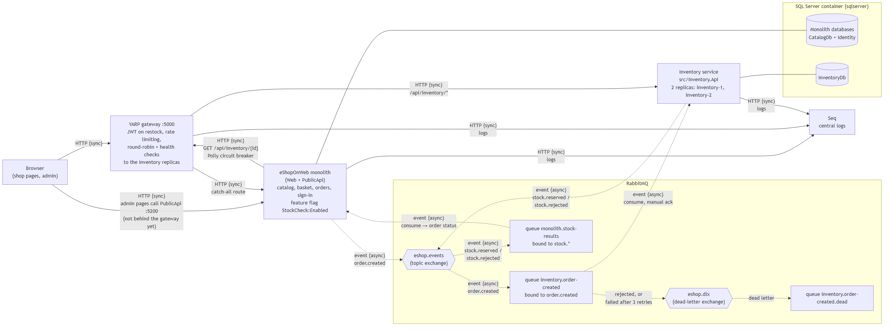
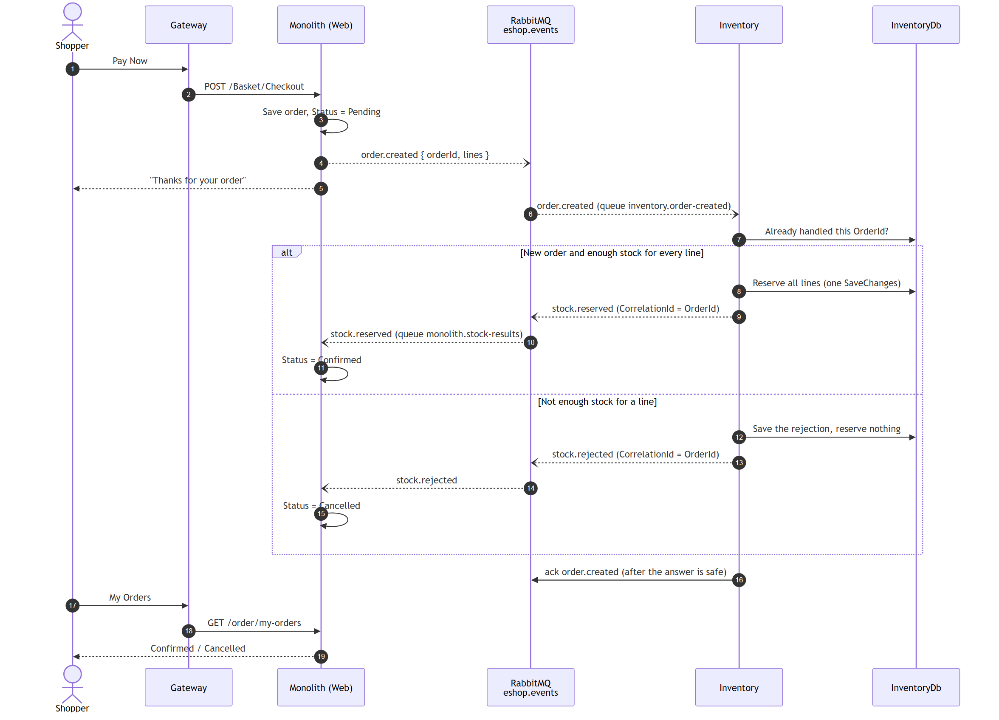
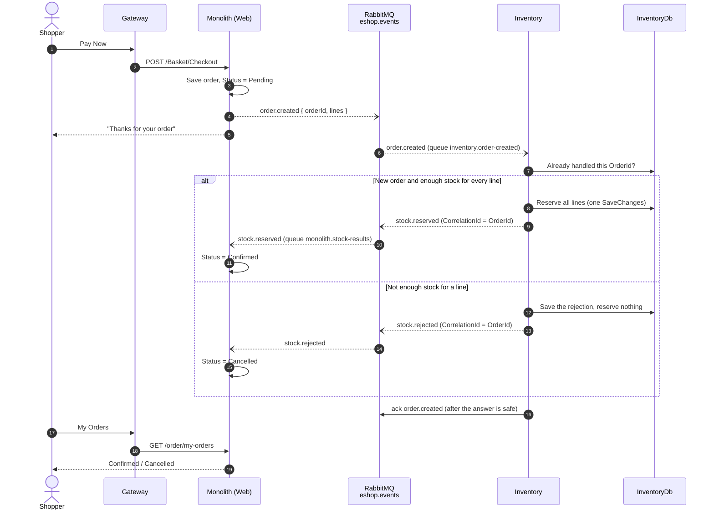

# eShopOnWeb → microservices with the Strangler Pattern

[](https://github.com/shoaibalirts/eShopOnWeb/actions/workflows/ci-cd.yml)

This is my semester project. I take the monolithic [eShopOnWeb](https://github.com/NimblePros/eShopOnWeb) shop and start to move it to microservices with the **Strangler Pattern**. The shop keeps running the whole time, and one piece moves out at a time.

I work alone, so my instructor confirmed on 6/11-2026 that I build **one** microservice: **Inventory**. It owns the stock levels and checks every order. Catalog, basket, ordering, sign-in and all pages stay in the monolith for now.

**Green CI/CD run on `main`:** [run 44323361311](https://github.com/shoaibalirts/eShopOnWeb/actions/runs/44323361311) (commit `8dfc3bc`, 18/11-2026: 104 tests, 3 images pushed to GHCR, deploy and smoke test passed)

## Contents

- [Run it](#run-it)
- [Reset before a demo](#reset-before-a-demo)
- [What you can try](#what-you-can-try)
- [Architecture](#architecture)
- [The order saga](#the-order-saga)
- [APIs](#apis)
- [Architecture decisions](#architecture-decisions)
- [CI/CD](#cicd)
- [Tests](#tests)
- [Repository map](#repository-map)

## Run it

You need Docker Desktop (with Docker Compose v2) and nothing else.

```bash
docker compose up -d --build
```

The first build takes a few minutes. When it is done:

| What | URL | Login |
|---|---|---|
| **The shop** (through the gateway) | http://localhost:5000 | `demouser@microsoft.com` / `Pass@word1` |
| Admin pages | http://localhost:5000/admin | `admin@microsoft.com` / `Pass@word1` |
| **Inventory API (Swagger)** | http://localhost:5000/api/inventory/swagger | – |
| PublicApi (Swagger, from eShopOnWeb) | http://localhost:5200/swagger | – |
| Seq (central logs) | http://localhost:5341 | – |
| RabbitMQ management | http://localhost:15672 | `eshop` / `eshop` |

The gateway (port 5000) is the only way into the shop and Inventory. The monolith and Inventory have no host ports.

To check that everything works, run the smoke test:

```powershell
.\scripts\smoke-test.ps1          # Windows PowerShell
```

```bash
bash scripts/smoke-test.sh        # Linux, macOS, Git Bash (used by CI)
```

It checks `/health` of all three services and places two orders. One must become `Confirmed` and one `Cancelled`. The CI deploy job runs the same script.

## Reset before a demo

```bash
docker compose down -v
docker compose up -d
```

`down` removes the containers. SQL Server has no volume, so all databases (catalog, users, orders, `InventoryDb`) are gone. `-v` also removes the anonymous volumes of RabbitMQ and Seq, so queues and logs start empty too. On startup everything is seeded again: the catalog, the two demo users, and the stock (25 of each product, but only 3 of item 2, the mug). Order numbers start at 1 again.

## What you can try

| Try | What you should see |
|---|---|
| Buy 1 of anything, then open **My Orders** | The order is `Pending` for a moment, then `Confirmed` |
| Buy 4 mugs (".NET Black & White Mug", item 2) | The order becomes `Cancelled`, because there are only 3 |
| Look at the home page | "In stock: 25" under each product |
| `docker compose stop inventory-api inventory-api-2`, then reload the home page 3 times | "Availability unknown". From the 3rd load the page is fast again (circuit breaker open) |
| Search Seq for `CorrelationId = '1'` | Log lines from the monolith and Inventory for order 1, with the same `TraceId` as the gateway's request |
| The rollback switch: `STOCK_CHECK_ENABLED=false docker compose up -d eshopwebmvc` | New orders stay `Pending`, and Inventory is not used at all, like before the migration |

## Architecture



| Part | What it does |
|---|---|
| **Gateway** (`src/Gateway`, YARP) | The single entry point. `/api/inventory/*` goes to Inventory, everything else goes to the monolith (catch-all). It validates the JWT on restock, rate-limits the inventory routes, and does round-robin over 2 Inventory replicas. |
| **Monolith** (`src/Web` + `src/PublicApi`) | All pages, the catalog, the basket, orders and sign-in. It publishes `order.created`, consumes `stock.*`, and asks Inventory for availability on the home page. |
| **Inventory** (`src/Inventory.Api`) | Owns stock and reservations in its own database `InventoryDb`. 2 replicas. |
| **RabbitMQ** | Topic exchange `eshop.events` with the routing keys `order.created`, `stock.reserved` and `stock.rejected`, and the dead-letter exchange `eshop.dlx`. |
| **Seq** | Logs from all three applications, searchable by `CorrelationId` and `TraceId`. |
| **SQL Server** | One container with a separate database per service: `CatalogDb` and `Identity` for the monolith, `InventoryDb` for Inventory. |

More detail is in [architecture/02-target-architecture.md](architecture/02-target-architecture.md). The business contexts are in [architecture/00-business-story.md](architecture/00-business-story.md).

## The order saga

An order now involves two services with two databases, so one transaction can't cover it. Instead the services work as a choreographed saga, and the order's status shows how far it has come.





How it stays correct:

- **At-least-once delivery.** Inventory acks only after its answer is published with publisher confirms. A crash means the message is delivered again, not lost.
- **Idempotent receiver.** A reservation's key is the `OrderId`, so a duplicate message gets the first answer again and reserves nothing.
- **All or none.** All lines of an order are reserved in one `SaveChanges`, and stock never goes below zero. `rowversion` on each stock row is meant to stop two replicas from selling the last unit twice (a test for this is future work).
- **Retry limit and dead letters.** A message that fails 3 retries, or can't be read, goes to the queue `inventory.order-created.dead`.
- **The monolith's side.** `Confirm()` and `Cancel()` only change a `Pending` order, so a duplicate answer does nothing.

## APIs

### Inventory (`src/Inventory.Api`), through the gateway

| Method and path | What | Protection |
|---|---|---|
| `GET /api/inventory/{itemId}` | Stock level: `{ "catalogItemId": 1, "quantity": 25 }`, or 404 | Rate limit (100 per 10 s per IP) |
| `PUT /api/inventory/{itemId}/stock` | Set the stock level. Body `{ "quantity": 30 }`. 400 if negative, 409 if the stock changed meanwhile | JWT from the monolith with the role `Administrators`, plus the rate limit |
| `GET /api/inventory/swagger` | Swagger UI | – |
| `GET /health/inventory` | Inventory's health (`InventoryDb`) | – |

Get a token from the monolith's PublicApi, then call the restock endpoint:

```bash
TOKEN=$(curl -s -X POST localhost:5200/api/authenticate -H "Content-Type: application/json" \
  -d '{"username":"admin@microsoft.com","password":"Pass@word1"}' | grep -oE '"token":"[^"]*"' | cut -d'"' -f4)
curl -i -X PUT localhost:5000/api/inventory/1/stock -H "Authorization: Bearer $TOKEN" \
  -H "Content-Type: application/json" -d '{"quantity":30}'
```

No token gives 401, a token without the role `Administrators` (for example `demouser`) gives 403, and more than 100 calls in 10 seconds give 429 with `Retry-After`.

### Messages (RabbitMQ, exchange `eshop.events`)

| Routing key | From → to | Body |
|---|---|---|
| `order.created` | Monolith → Inventory (queue `inventory.order-created`) | `{ "orderId": 1, "lines": [ { "catalogItemId": 1, "quantity": 2 } ] }` |
| `stock.reserved` | Inventory → monolith (queue `monolith.stock-results`) | `{ "orderId": 1 }` |
| `stock.rejected` | Inventory → monolith (queue `monolith.stock-results`) | `{ "orderId": 1, "reason": "..." }` |

Every message has `correlation_id` = the OrderId and a `traceparent` header for the logs.

### Health

| URL | Answers |
|---|---|
| http://localhost:5000/health | The gateway itself |
| http://localhost:5000/health/monolith | The monolith (`CatalogDb` and `Identity`) |
| http://localhost:5000/health/inventory | Inventory (`InventoryDb`) |

## Architecture decisions

| Decision | Why | Trade-off |
|---|---|---|
| **Inventory** is the first service | Clear ownership of one piece of data (stock), and a real business rule to protect. See [docs/report/01-why-inventory.md](docs/report/01-why-inventory.md). | Catalog and ordering stay coupled inside the monolith. |
| **YARP gateway** as the Strangler facade | One entry point. Moving the next piece means adding one route in `appsettings.json`. | One more process, and a single point of failure. |
| **Database per service** | Inventory can change its tables freely. The monolith only sees stock through the API and messages. | No joins and no shared transactions across services. |
| **Messages for checkout, HTTP for reading** | Checkout must not fail when Inventory is down. The order waits as `Pending`. Reading stock for a page needs an answer now. | Eventual consistency: an order is `Pending` for a moment. |
| **Choreographed saga** with order status | No coordinator to build or run. | The flow is spread over two services, and there is no timeout or compensation yet. |
| **RabbitMQ.Client directly**, not MassTransit | I wanted to understand and show acks, confirms, routing and dead letters myself. | More code than a framework would need. |
| **JWT checked at the gateway** with the monolith's key | No new identity service. Inventory never handles tokens. | Shared symmetric key, and no check inside Inventory. |
| **Feature flag `StockCheck:Enabled`** | The Strangler Pattern's way back: off means the shop works exactly as before. | Two code paths to keep working. |
| **Polly circuit breaker** on the stock call | A slow or dead Inventory must not make the home page slow. | The page shows "Availability unknown" instead of a stock number. |

The full reasoning is in the report drafts in [docs/report](docs/report).

## CI/CD

[`.github/workflows/ci-cd.yml`](.github/workflows/ci-cd.yml) runs on every push:

1. **build-and-test:** restore, build in Release, and run 5 test projects. A failing test stops the pipeline here.
2. **images:** build the Docker images `eshopwebmvc`, `gateway` and `inventory-api`. From `main` they are pushed to GHCR as `ghcr.io/shoaibalirts/<image>:sha-<commit>` and `:latest`.
3. **deploy** (only `main`): pull exactly those images, run `docker compose up` on the runner, then run `scripts/smoke-test.sh`.

## Tests

```bash
dotnet test tests/UnitTests/UnitTests.csproj
dotnet test tests/Inventory.Tests/Inventory.Tests.csproj
dotnet test tests/Gateway.Tests/Gateway.Tests.csproj
dotnet test tests/FunctionalTests/FunctionalTests.csproj
dotnet test tests/IntegrationTests/IntegrationTests.csproj
```

| Project | What my tests cover |
|---|---|
| `Inventory.Tests` | Reservation rules (all or none, never below zero, one per `OrderId`), retry count, the queue contract, and the HTTP API with `WebApplicationFactory` (seeded stock, 404, restock 200 / 400, OpenAPI, health) |
| `Gateway.Tests` | The real gateway with `WebApplicationFactory`: 401 / 403 / pass-through for restock, 429 with `Retry-After` |
| `UnitTests` | Order status changes, the `order.created` contract, the circuit breaker opening and its fallback, the queue contract |

`EndToEndTests` (Playwright, from eShopOnWeb) need a browser and an HTTPS developer certificate, so CI doesn't run them.

## Repository map

| Path | What |
|---|---|
| `src/Inventory.Api` | The Inventory microservice |
| `src/Gateway` | The YARP gateway |
| `src/Web/Messaging` | The monolith's side of the messaging: publisher, consumer, topology |
| `src/Web/Services/InventoryAvailabilityService.cs` | The stock call with Polly |
| `tests/Inventory.Tests`, `tests/Gateway.Tests` | My new test projects |
| `scripts/smoke-test.sh`, `scripts/smoke-test.ps1` | The end-to-end check (bash for CI, PowerShell for Windows) |
| `architecture/` | Business story, monolith flows, target architecture, plan, diagrams |
| `docs/report/` | Report drafts |

Based on [NimblePros/eShopOnWeb](https://github.com/NimblePros/eShopOnWeb) (MIT license).
