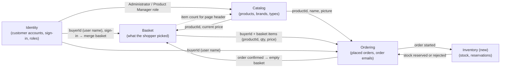

# The business story behind the migration

This document explains **why** I am changing the eShopOnWeb architecture, in words a non-developer can follow.
It also maps the shop into its natural business areas.
The detailed technical flows are in [01-monolith-flows.md](01-monolith-flows.md).
[02-target-architecture.md](02-target-architecture.md) is the single source of truth for services, extraction order and event names.

A few terms are used throughout:

- **Monolith**: one big application. All features are built, tested and deployed together, and share one database.
- **Microservice**: a small, separate application that owns one business area and its own data. It talks to other services over the network.
- **Bounded context**: a business area with its own clear words and rules. For example, a "price" in the catalog can mean something different from a "price" on an order. Each bounded context is a natural candidate for one microservice.
- **Strangler Pattern**: a way to replace an old system piece by piece. New services grow around the old one and take over one feature at a time, until the old system can be switched off. The name comes from the strangler fig tree, which slowly grows around a host tree.

---

## 1. The business lead's story

> I run an online shop for developers.
> I sell branded merchandise: mugs, T-shirts, sweatshirts, sticker sheets and USB sticks.
> The brands are names that developers love, like .NET, Azure, Visual Studio and SQL Server.
>
> My customers are developers and tech fans.
> Many of them just browse without an account.
> They can still fill a basket.
> When they want to buy, they sign in, and the shop keeps what they already picked.
> Inside the company, my product managers and administrators keep the product list up to date.
>
> In the beginning, one website did everything, and that was fine.
> Now the shop is growing, and the single website is holding it back:
>
> - **One mistake stops everything.** A bug in checkout can take the whole shop down, including the product pages.
> - **Every change is a big release.** Changing a product photo and changing how orders work go out together. So I release rarely, and every release is risky.
> - **I cannot grow the busy parts alone.** On sale days, thousands of people browse but only a few buy. I still have to make the whole website bigger, which is expensive.
> - **Teams get in each other's way.** Everyone works in the same code and the same database. Nobody can move fast without asking everyone else.
> - **Important features are missing.** I do not check stock before I sell. I do not take payments in the shop itself. Every order is shipped to one fixed test address. Adding these to the current website would make it even bigger and harder to change.
> - **Orders can go wrong half-way.** Placing an order is several separate steps. If the system crashes in the middle, a customer can end up with an order *and* a full basket.
>
> So I will split the most tangled and busiest parts of the shop into smaller services: products, baskets, orders and stock.
> Each service can be changed, released and scaled on its own.
>
> I will **not** rebuild everything at once. That is too risky, and the shop must stay open.
> Instead I use the Strangler Pattern.
> I put a front door (a **gateway**) in front of the shop.
> At first it sends every visitor to the old website.
> Then I build one new service at a time, and move that part of the traffic to it.
> If something goes wrong, I simply send the traffic back.
> I start with the product catalog, because it is the safest part.
> Stock is a brand new service, and orders move last, because they are the most tangled part.
> Customer accounts stay in the old website, and payments and the real shipping address come later.
> Step by step, the old website does less and less, until it only serves the pages and handles customer accounts.

---

## 2. Context map

A **context map** shows the business areas and what information passes between them.
Each arrow points from the area that *gives* the information to the area that *uses* it.

The dotted arrow is a hidden link in today's code: every product page reads the basket table to show the item count in the header.

**Notes on the shared words**

- **productId** is the product's number (`CatalogItem.Id`). Basket and Ordering store it as `CatalogItemId`.
- **buyerId** is a plain text value. For a signed-in customer it is their user name (e-mail). For an anonymous visitor it is a random ID kept in a **cookie** (a small piece of data the browser stores) called `eShop`.
- Inventory is new and doesn't exist in the code today. The other four areas live in the same Web application. Catalog, Basket and Ordering also share **one database** (`CatalogContext`). Only Identity has its own database (`AppIdentityDbContext`).

---

## 3. Catalog

### Responsibility
Catalog owns the list of products the shop sells.
It knows each product's name, description, price, picture, brand and type.
Shoppers read it to browse and filter. Administrators change it.

### Key words (ubiquitous language)
**Ubiquitous language** means the words the business and the developers both use for this area.

- **Catalog item / product**: one thing the shop sells, e.g. ".NET Bot Black Sweatshirt".
- **Brand**: who the product is about, e.g. ".NET", "Azure".
- **Type**: what kind of product it is, e.g. "Mug", "T-Shirt".
- **Price**: the current selling price.
- **Picture**: the product photo.
- **Filter / page**: how the shopper narrows down and steps through the product list.

### What belongs to it in eShopOnWeb

| Kind | Items |
|---|---|
| Domain classes | `CatalogItem`, `CatalogBrand`, `CatalogType` (`src/ApplicationCore/Entities`) |
| Queries (specifications) | `CatalogFilterSpecification`, `CatalogFilterPaginatedSpecification`, `CatalogItemsSpecification`, `CatalogItemNameSpecification` |
| Services | `CatalogViewModelService`, `CachedCatalogViewModelService`, `CatalogItemViewModelService`, `UriComposer` |
| Pages / UI | `Pages/Index` (shop front), `Pages/Admin/*`, `Pages/Shared/_product`, BlazorAdmin `CatalogItemPage/*` |
| API | `PublicApi/CatalogItemEndpoints`, `CatalogBrandEndpoints`, `CatalogTypeEndpoints` |
| Tables (CatalogDB) | `Catalog` (products), `CatalogBrands`, `CatalogTypes` |

### Needs from others / gives to others

- **Needs:** from Identity, only the *role* of the user, so that only Administrators and Product Managers can edit products.
- **Gives:** to Basket, the product's ID and current price. To Ordering, the product's ID, name and picture.

### Main flow: a shopper browses products

1. Shopper opens the shop's home page.
2. → They may pick a brand, a type, or a page number.
3. → The shop first looks in its short-term memory (**cache**: a fast store of recent answers) for this exact list.
4. → If it is not there, the shop reads the matching products, the total count, and all brands and types from the database.
5. → It builds the picture links and the page buttons.
6. → It keeps the result in the cache for next time.
7. → The shopper sees a grid of products with filters and an "Add to basket" button on each.

### Good candidate to extract first? **Yes, the best one.**

- It is almost only **reading**. Browsing never changes data, so moving it is low risk.
- It depends on almost nothing else. It only needs to know who is an admin.
- It gets the most traffic, so it gains the most from being scaled on its own.
- The PublicApi already has catalog endpoints, so a starting point exists.
- One thing to fix on the way: the basket counter in the page header reads the basket table directly. That link must become a call to the Basket service.

---

## 4. Basket

### Responsibility
Basket remembers what a shopper wants to buy before they buy it.
It works for both anonymous visitors and signed-in customers.
When a visitor signs in, their anonymous basket is merged into their account's basket.

### Key words (ubiquitous language)

- **Basket**: the shopper's current list of chosen products. One per buyer.
- **Basket item**: one product line in the basket, with a quantity.
- **Quantity**: how many of that product.
- **Unit price**: the price **at the moment the item was added** (a saved copy, also called a *snapshot*).
- **Buyer**: the person the basket belongs to (user name or anonymous ID).
- **Transfer / merge**: moving an anonymous basket into a signed-in customer's basket.

### What belongs to it in eShopOnWeb

| Kind | Items |
|---|---|
| Domain classes | `Basket`, `BasketItem` (`src/ApplicationCore/Entities/BasketAggregate`) |
| Queries | `BasketWithItemsSpecification`, `BasketQueryService` / `IBasketQueryService` (item count) |
| Services | `BasketService` / `IBasketService`, `BasketViewModelService` |
| Pages / UI | `Pages/Basket/Index`, `Pages/Shared/Components/BasketComponent` (header counter) |
| Tables (CatalogDB) | `Baskets`, `BasketItems` |

### Needs from others / gives to others

- **Needs:** from Catalog, the product's price when it is added, and the name and picture when the basket is shown. From Identity, the buyer's user name. Right after someone signs in, the web app asks Basket to merge the baskets. From Ordering, a signal when an order is confirmed, so it can empty the basket.
- **Gives:** to Ordering, the buyer ID and the list of items with quantities and saved prices. To every page header, the number of items in the basket.

### Main flow: a shopper adds a product to the basket

1. Shopper clicks **Add to basket** on a product.
2. → The shop looks up the product and its current price in the catalog.
3. → If the product no longer exists, the shopper is sent back to the home page.
4. → The shop works out who the buyer is: the user name if signed in, otherwise the ID in the `eShop` cookie (a new one is created if missing).
5. → It finds that buyer's basket, or creates a new empty one.
6. → If the product is already in the basket, the quantity goes up by one. Otherwise a new basket item is added with today's price.
7. → The basket is saved.
8. → The shopper is taken to the basket page, which shows each item with its name, picture, quantity and price.
9. → Later, when the shopper signs in, their anonymous basket is merged into their account's basket and the cookie is removed.

### Good candidate to extract first? **No, but a good second step.**

- It **writes** data on every click, so mistakes are felt directly by shoppers.
- It reads the catalog database directly, twice per flow. That must first become a call to the Catalog service, so Catalog should already be extracted.
- It must keep supporting both anonymous and signed-in buyers, and the sign-in merge.
- Once Catalog is out, Basket has clear edges and small data. It is a natural next service.

---

## 5. Ordering

### Responsibility
Ordering turns a basket into a placed order and keeps it as a permanent record.
It lets customers see their past orders and order details.
After an order is placed, it sends a confirmation e-mail.

### Key words (ubiquitous language)

- **Order**: a confirmed purchase by a buyer, with a date and a shipping address.
- **Order item**: one product line in an order, with units and unit price.
- **Item ordered**: a frozen copy of the product's ID, name and picture at the time of purchase. If the catalog changes later, old orders do not change.
- **Ship-to address**: where the order goes.
- **Total**: sum of unit price × units for all order items.
- **Checkout**: the step where the customer turns their basket into an order.
- **Order created**: today's in-process event (`OrderCreatedEvent`) that says "a new order exists". In the new design it becomes `OrderStartedIntegrationEvent`.

### What belongs to it in eShopOnWeb

| Kind | Items |
|---|---|
| Domain classes | `Order`, `OrderItem`, `CatalogItemOrdered`, `Address` (`src/ApplicationCore/Entities/OrderAggregate`) |
| Events | `OrderCreatedEvent`, `OrderCreatedHandler` (sends the e-mail through `IEmailSender`) |
| Queries | `CustomerOrdersSpecification`, `CustomerOrdersWithItemsSpecification`, `OrderWithItemsByIdSpec` |
| Services | `OrderService` / `IOrderService` |
| Pages / UI | `Pages/Basket/Checkout`, `Pages/Basket/Success`, `Controllers/OrderController` with `Features/MyOrders` and `Features/OrderDetails` |
| Tables (CatalogDB) | `Orders` (address stored in the same row), `OrderItems` (item-ordered copy stored in the same row) |
| Not used yet | `Buyer`, `PaymentMethod` (`BuyerAggregate`) exist as classes but have no table and no code using them. They hint at a future Payment area, which is out of scope for now. |

### Needs from others / gives to others

- **Needs:** from Basket, the buyer ID and the basket items with their saved prices. From Catalog, each product's name and picture for the frozen copy. From Identity, the signed-in user name (checkout requires sign-in).
- **Gives:** today, the "order created" signal, and only the e-mail sender listens. In the new design, Ordering announces when an order is started and when it is confirmed. Inventory listens for started orders, and Basket empties the basket when an order is confirmed. Basket does not empty on order start, so a customer whose order is rejected keeps their basket.

### Main flow: a customer places an order

1. Customer clicks **Checkout** on the basket page.
2. → If they are not signed in, they are asked to sign in first.
3. → The shop saves any quantity changes they made.
4. → It reads their basket. If it is empty, they are sent back to the basket page.
5. → It reads the name and picture of every product in the basket from the catalog.
6. → It builds an order item for each line, using the frozen product details and the price saved in the basket.
7. → It creates and saves the order with today's date and the shipping address (today always the same test address).
8. → It announces "order created", and a confirmation e-mail is sent.
9. → It deletes the basket.
10. → The customer sees the "Thank you" page and can later find the order under **My Orders**.

### Good candidate to extract first? **No, it should be last.**

- It reaches into **three** business areas (Basket, Catalog and its own Orders) in one database. This is the most tangled part of the shop.
- The steps "save order" and "delete basket" are not done together. When they become separate services, I need a planned sequence of events instead.
- On the positive side, it already uses an **event** ("order created") to send the e-mail. That is a clean seam. It can later be replaced by `OrderStartedIntegrationEvent`, a message on a message broker (a post office between services, in my case RabbitMQ).
- It is the place where the new stock check plugs in, so it should move once Catalog, Basket and Inventory are in place.

---

## 6. Identity

### Responsibility
Identity knows who people are.
It handles registration, sign-in, sign-out and passwords.
It also stores roles that decide who may manage products and users.

### Key words (ubiquitous language)

- **User / account**: a registered person, identified by e-mail.
- **Sign in / sign out**: proving who you are, and ending that session.
- **Role**: a group with special rights. Today: **Administrators** and **Product Managers**.
- **Token**: a signed digital pass the PublicApi hands out after sign-in, so other apps (like the admin app) can prove who the user is. Technically a JWT (JSON Web Token).
- **Anonymous buyer**: a visitor without an account, known only by a cookie ID.

### What belongs to it in eShopOnWeb

| Kind | Items |
|---|---|
| Domain classes | `ApplicationUser`, `AppIdentityDbContext`, `AppIdentityDbContextSeed` (`src/Infrastructure/Identity`) |
| Services | `IdentityTokenClaimService` / `ITokenClaimsService` |
| Pages / UI | `Areas/Identity/Pages/Account/*` (Login, Logout, Register, ConfirmEmail), `Controllers/ManageController`, `Controllers/UserController`, BlazorAdmin `UserPage/*` and `RolePage/*` |
| API | `PublicApi/AuthEndpoints`, `UserManagementEndpoints`, `RoleManagementEndpoints`, `RoleMembershipEndpoints` |
| Tables (IdentityDB, separate database) | the standard ASP.NET Identity tables: `AspNetUsers`, `AspNetRoles`, `AspNetUserRoles`, `AspNetUserClaims`, `AspNetUserLogins`, `AspNetUserTokens`, `AspNetRoleClaims` |

### Needs from others / gives to others

- **Needs:** nothing from the other areas to do its own job. Today the sign-in page merges the anonymous basket in-process. In the new design, the same page calls the Basket service over HTTP.
- **Gives:** the buyer ID (user name) to Basket and Ordering. Roles to Catalog admin. Tokens to the admin app, the web app and the gateway, which checks them.

### Main flow: a visitor signs in

1. Visitor clicks **Login** and enters e-mail and password.
2. → The shop checks the password against the Identity database.
3. → If it is wrong, an error is shown and nothing else happens.
4. → If it is right, the visitor is now a signed-in customer.
5. → The shop checks for an anonymous basket cookie.
6. → If one exists, Basket moves those items into the customer's own basket.
7. → The cookie is deleted.
8. → The customer is sent back to where they were, now with their name shown in the header.

### Good candidate to extract first? **No. It stays in the monolith for this project.**

- **For moving it:** it already has its **own database**, and the PublicApi already issues tokens. Its data is the least tangled of all.
- **Against moving it:** *every* other area depends on it. If it breaks, nobody can sign in or check out, and admins are locked out.
- **Against moving it:** security work (cookie and token sharing between old and new parts) must be done carefully, and the assignment doesn't require it.
- **Decision:** I keep it where it is. The gateway and new services check the existing tokens. Moving it is listed under "Later / out of scope" in [PLAN.md](PLAN.md).

---

## 7. Inventory (new)

### Responsibility
Inventory keeps track of how much stock the shop has.
It reserves products when a customer checks out.
It does not exist in eShopOnWeb today. I build it from scratch as a new service.

### Key words (ubiquitous language)

- **Stock**: how many of a product the shop has.
- **Reservation**: stock set aside for one order, so that nobody else can buy it.

### Needs from others / gives to others

- **Needs:** from Ordering, a signal when an order is started. Stock for the existing products is seeded when the service starts.
- **Gives:** to Ordering, the signal that stock was reserved or rejected.

### Main flow: stock is reserved at checkout

1. Ordering announces that a new order has started.
2. → Inventory checks whether there is enough stock for every line.
3. → If there is, it reserves the stock and announces that stock is reserved.
4. → If not, it announces that stock is rejected, and the order is cancelled.

### Good candidate to extract first? **No, and nothing is extracted.**

- It is new code, so building it can't break the shop.
- It only becomes useful once Ordering sends it orders, so I build it just before Ordering moves.

---

## 8. Extraction order

[02-target-architecture.md](02-target-architecture.md) is the single source of truth for this order.

| Step | Area | Why this order |
|---|---|---|
| 0 | Gateway in front of the monolith | The Strangler front door. All traffic still goes to the old website. |
| 1 | **Catalog** | Mostly reading, few dependencies, highest traffic. |
| 2 | **Basket** | Clear edges once Catalog is an API. Must keep anonymous baskets and the sign-in merge. |
| 3 | **Inventory** (new) | New code that can't break the shop. Must be ready before Ordering uses it. |
| 4 | **Ordering** | Most tangled. The checkout steps are driven by events, and today's in-process event is replaced by RabbitMQ events. |

Identity stays in the monolith, and Payment is out of scope. See [PLAN.md](PLAN.md).
