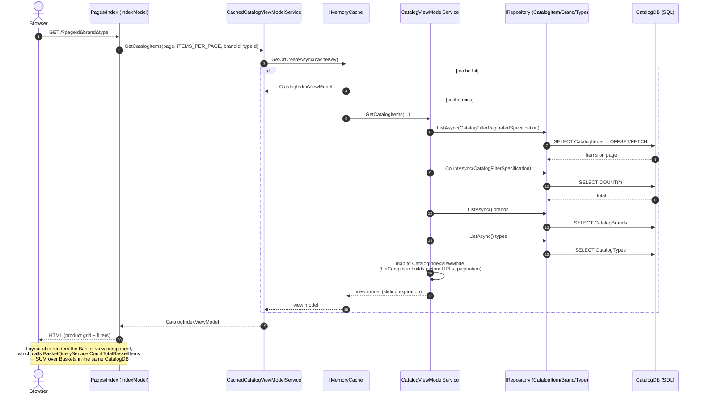
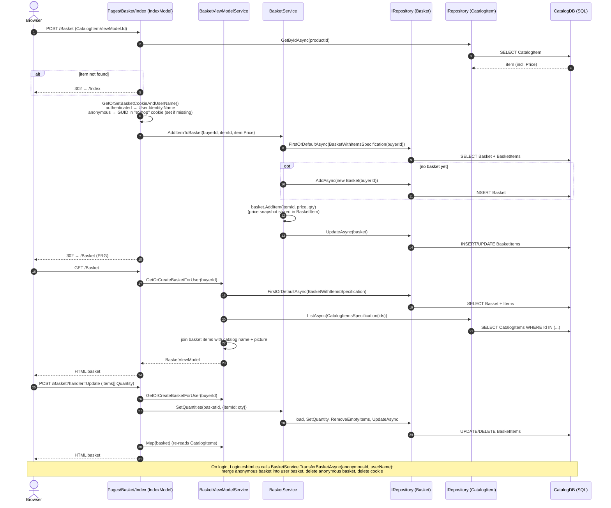
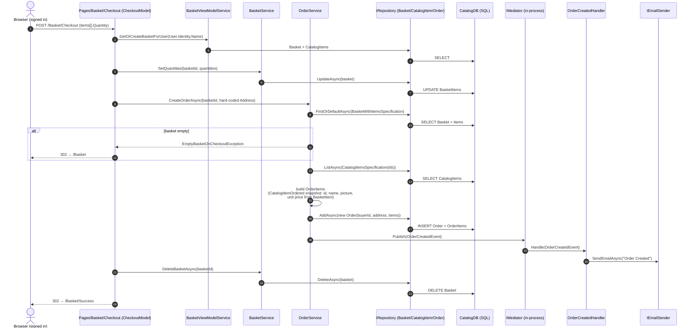

# As-is: the three key monolith flows

These diagrams show how the **current monolith** (`src/Web`) handles the three core shopping flows.
They are the baseline for the Strangler Pattern migration: every arrow that crosses a future
service boundary is a coupling point that has to become an HTTP call or a message.

Participants map to real classes:

| Participant | Code |
|---|---|
| Razor Page | `src/Web/Pages/Index.cshtml.cs`, `src/Web/Pages/Basket/Index.cshtml.cs`, `src/Web/Pages/Basket/Checkout.cshtml.cs` |
| ViewModel services | `src/Web/Services/CachedCatalogViewModelService.cs`, `CatalogViewModelService.cs`, `BasketViewModelService.cs` |
| Domain services | `src/ApplicationCore/Services/BasketService.cs`, `OrderService.cs` |
| Repository | `src/Infrastructure/Data/EfRepository.cs` (generic `IRepository<T>`) |
| CatalogDB | **one** SQL Server database (`CatalogContext`) holding catalog, baskets **and** orders |
| IdentityDB | separate `AppIdentityDbContext` (users/roles) |

---

## 1. Browse catalog

`GET /` (optionally `?pageId=n&BrandFilterApplied=x&TypesFilterApplied=y`)

**Observations for the migration**
- Pure read flow, no writes — the safest first candidate to strangle into a **Catalog service**.
- Cache lives in-process (`IMemoryCache`); it moves with the service (or becomes gateway/HTTP caching).
- The basket counter in the header reads the Basket table on *every* page — a hidden Catalog↔Basket coupling.

---

## 2. Basket (view / add item / update quantities)

`GET /Basket`, `POST /Basket` (add from product card), `POST /Basket?handler=Update`

**Observations for the migration**
- Basket reads `CatalogItem` directly from the shared DB twice (price at add-time, name/picture at view-time).
  In a **Basket service** this becomes a call to the Catalog API (or a local read-model fed by `ProductPriceChanged` events).
- Buyer identity is either a username or an anonymous GUID cookie — the gateway/Basket service must keep supporting both.
- Login triggers a basket merge — an Identity → Basket dependency to preserve.

---

## 3. Checkout / place order

`GET /Basket/Checkout` then `POST /Basket/Checkout` (requires `[Authorize]`)

**Observations for the migration**
- `OrderService` reaches into **three aggregates** (Basket, CatalogItem, Order) in one database — the main thing to untangle.
- No **stock check / reservation** and no **payment** — this is exactly where the new Inventory and Payment services plug in.
- The three writes (update quantities → insert order → delete basket) are **not in one transaction**; a crash between
  them leaves an order *and* a basket. In the microservice design this becomes an explicit saga with compensations.
- `OrderCreatedEvent` is already a domain event published in-process via Mediator — the natural seam to replace with a
  RabbitMQ integration event (`OrderCreated`) consumed by Inventory, Payment, Basket and Notification.
- Shipping address is hard-coded (`123 Main St.`).
