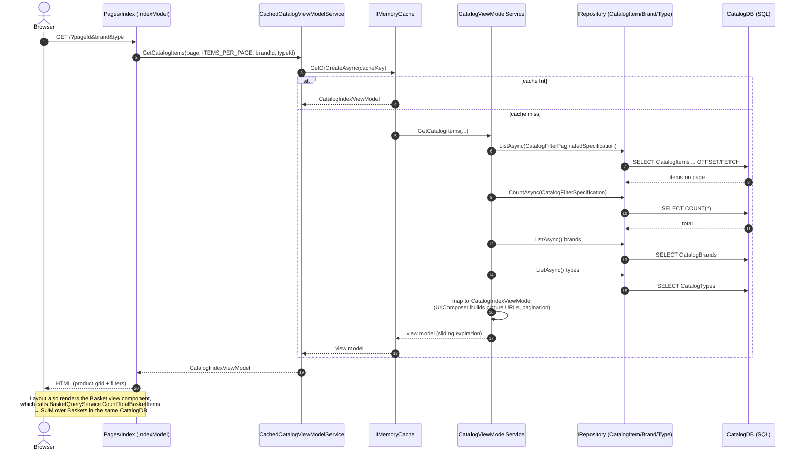
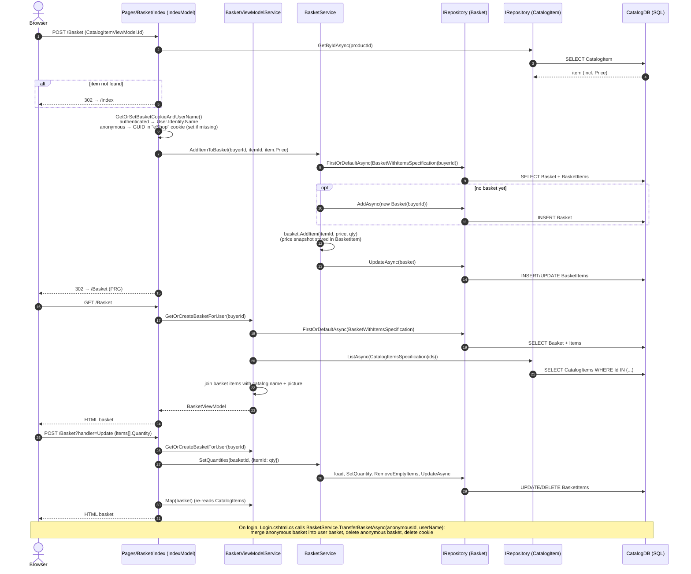
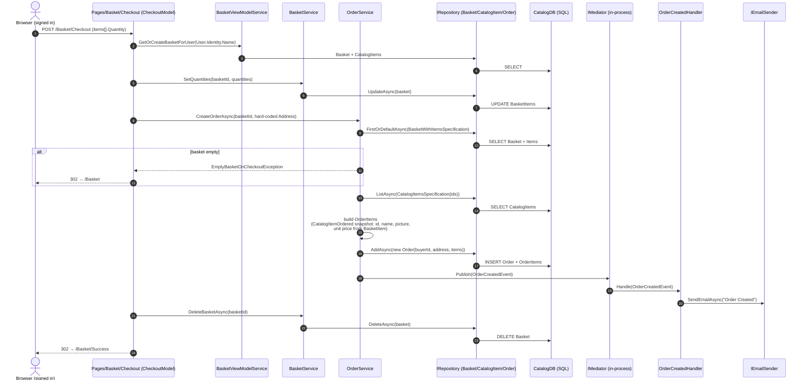

# As-is: the three key monolith flows

These diagrams show how the **current monolith** (`src/Web`) handles the three core shopping flows.
They are the baseline for the Strangler Pattern migration: every arrow that crosses a future
service boundary is a coupling point that has to become an HTTP call or a message.

Participants map to real classes:

| Participant | Code |
|---|---|
| Razor Page | `src/Web/Pages/Index.cshtml.cs`, `src/Web/Pages/Basket/Index.cshtml.cs`, `src/Web/Pages/Basket/Checkout.cshtml.cs` |
| ViewModel services | `src/Web/Services/CachedCatalogViewModelService.cs`, `CatalogViewModelService.cs`, `BasketViewModelService.cs` |
| Domain services | `src/ApplicationCore/Services/BasketService.cs`, `OrderService.cs` |
| Repository | `src/Infrastructure/Data/EfRepository.cs` (generic `IRepository<T>`) |
| CatalogDB | **one** SQL Server database (`CatalogContext`) holding catalog, baskets **and** orders |
| IdentityDB | separate `AppIdentityDbContext` (users/roles) |

---

## 1. Browse catalog

`GET /` (optionally `?pageId=n&BrandFilterApplied=x&TypesFilterApplied=y`)

**In plain English**

1. The shopper opens the home page, optionally choosing a page number, a brand or a product type.
2. The home page asks the catalog service for the products to show.
3. The catalog service first checks its short-term memory (the cache) for this exact list.
4. If the list is in the cache, it is used straight away and steps 5–9 are skipped.
5. Otherwise, the shop asks the database for the products on the requested page.
6. It asks the database how many products match in total, so it can draw the page buttons.
7. It reads all brands and all product types, to fill the filter drop-downs.
8. It builds the full picture link for each product and works out the page buttons.
9. It saves the result in the cache, so the next shopper gets it faster.
10. The home page receives the finished list.
11. The shopper sees the product grid with its filters.
12. On every page, the header also shows how many items are in the basket. To get that number, the shop reads the basket table in the same database.

**Observations for the migration**
- Pure read flow, no writes — the safest first candidate to strangle into a **Catalog service**.
- Cache lives in-process (`IMemoryCache`); it moves with the service (or becomes gateway/HTTP caching).
- The basket counter in the header reads the Basket table on *every* page — a hidden Catalog↔Basket coupling.

---

## 2. Basket (view / add item / update quantities)

`GET /Basket`, `POST /Basket` (add from product card), `POST /Basket?handler=Update`

**In plain English**

*Adding a product*

1. The shopper clicks **Add to basket** on a product.
2. The basket page looks up that product in the catalog to get its current price.
3. If the product no longer exists, the shopper is sent back to the home page.
4. The shop works out who the buyer is. A signed-in shopper is known by their user name. An anonymous shopper is known by a random ID stored in a cookie called `eShop`, which is created if it is missing.
5. The basket service loads that buyer's basket and its items.
6. If the buyer has no basket yet, a new empty one is created and saved.
7. The product is added to the basket together with today's price. If it is already there, its quantity goes up instead.
8. The updated basket is saved.
9. The shopper is redirected to the basket page. Redirecting stops the browser from adding the item twice if the page is refreshed.

*Viewing the basket*

10. The basket page loads the buyer's basket and its items.
11. It reads the matching products from the catalog to get their names and pictures.
12. It combines the two and shows the basket.

*Changing quantities*

13. The shopper changes some quantities and clicks **Update**.
14. The basket service saves the new quantities and removes any item set to zero.
15. The page reads the product names and pictures again and shows the updated basket.

*Signing in*

16. When an anonymous shopper signs in, their cookie basket is merged into their account's basket. The old basket and the cookie are then deleted.

**Observations for the migration**
- Basket reads `CatalogItem` directly from the shared DB twice (price at add-time, name/picture at view-time).
  In a **Basket service** this becomes a call to the Catalog API.
- Buyer identity is either a username or an anonymous GUID cookie — the gateway/Basket service must keep supporting both.
- Login triggers a basket merge — an Identity → Basket dependency to preserve.

---

## 3. Checkout / place order

`GET /Basket/Checkout` then `POST /Basket/Checkout` (requires `[Authorize]`)

**In plain English**

1. The signed-in customer confirms their basket on the checkout page. Anyone not signed in is asked to sign in first.
2. The checkout page loads the customer's basket and the product details.
3. Any quantity changes the customer made are saved to the basket.
4. The order service asks to create an order from this basket. The shipping address is always the same hard-coded test address (`123 Main St.`).
5. The order service reads the basket again.
6. If the basket is empty, the customer is sent back to the basket page.
7. It reads the name and picture of every product in the basket from the catalog.
8. For each basket line, it creates an order line. Each line holds a frozen copy of the product's ID, name and picture, plus the price saved in the basket.
9. The order and its lines are saved.
10. The order service announces "order created" inside the application.
11. A listener picks up that announcement and sends an "Order Created" e-mail.
12. The checkout page deletes the basket.
13. The customer is redirected to the "Thank you" page.

These are separate saves (steps 3, 9 and 12), not one all-or-nothing unit. A crash between them can leave both an order and a full basket.

**Observations for the migration**
- `OrderService` reaches into **three aggregates** (Basket, CatalogItem, Order) in one database — the main thing to untangle.
- No **stock check / reservation** and no **payment** — the new Inventory service adds the stock check. Payment is out of scope for now.
- The three writes (update quantities → insert order → delete basket) are **not in one transaction**; a crash between
  them leaves an order *and* a basket. In the microservice design this becomes a sequence of events.
- `OrderCreatedEvent` is already a domain event published in-process via Mediator — the natural seam to replace with a
  RabbitMQ integration event (`OrderStartedIntegrationEvent`) consumed by Inventory.
- Shipping address is hard-coded (`123 Main St.`).
