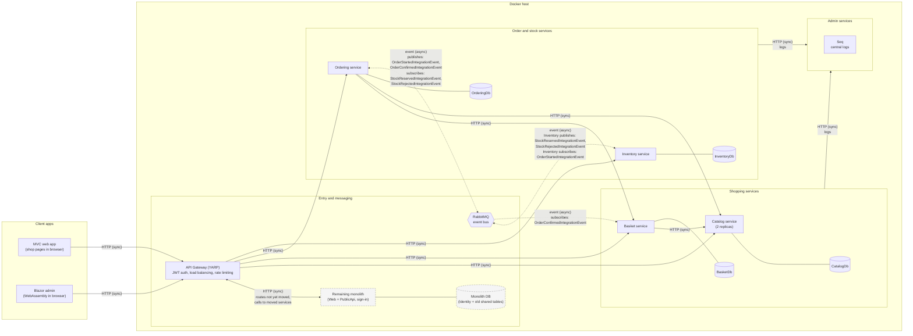

# Target architecture

This is my own microservice design for eShopOnWeb, sized for one developer and the deadline of 23/11-2026. It builds on the business areas in [00-business-story.md](00-business-story.md),
the code coupling in [01-monolith-flows.md](01-monolith-flows.md), and the instructors' eShopOnContainers picture.

This document is the single source of truth for services, extraction order and event names. The work is planned in [PLAN.md](PLAN.md).

The diagram shows the system **during migration**. The monolith (dashed boxes) gets smaller at each step. At the end it still serves the pages and handles sign-in, user management and JWT tokens.

Solid arrows are HTTP calls, where the caller waits for an answer. Dotted arrows are events, where the sender does not wait.
Plain lines join a service to the database only it may use.

## Services

| Service | Responsibility | Database | Talks to (sync) | Events published | Events subscribed |
|---|---|---|---|---|---|
| **Catalog** | Products, brands, types, current prices | CatalogDb (SQL Server) | None | None | None |
| **Basket** | Baskets for signed-in and anonymous buyers, merge at sign-in | BasketDb (SQL Server) | Catalog (price, name, picture) | None | `OrderConfirmedIntegrationEvent` |
| **Ordering** | Placing orders, order history, confirmation e-mail, order status | OrderingDb (SQL Server) | Basket (items), Catalog (name, picture) | `OrderStartedIntegrationEvent`, `OrderConfirmedIntegrationEvent` | `StockReservedIntegrationEvent`, `StockRejectedIntegrationEvent` |
| **Inventory** | Stock levels and reservations at checkout | InventoryDb (SQL Server) | None | `StockReservedIntegrationEvent`, `StockRejectedIntegrationEvent` | `OrderStartedIntegrationEvent` |

The gateway calls all four services. Sign-in stays in the monolith: `PublicApi` and `Web` issue JWT tokens with `ITokenClaimsService`, and the gateway validates them.

**Checkout in short:** Ordering saves a *Pending* order and publishes `OrderStartedIntegrationEvent`. Inventory tries to reserve all the stock.
If it can, it publishes `StockReservedIntegrationEvent`. Ordering then marks the order *Confirmed*, sends the e-mail and publishes `OrderConfirmedIntegrationEvent`, and Basket empties the basket.
If it can't, it publishes `StockRejectedIntegrationEvent`. Ordering marks the order *Cancelled*, and the customer keeps their basket.

## Differences from the instructors' suggestion

### Kept

| Part | Why |
|---|---|
| Gateway as the single entry point | The assignment requires it, and it lets me move traffic one route at a time. |
| Catalog, Ordering and Basket services | They match the business areas in my business story. |
| A database per service | The assignment requires it. Today Catalog, Basket and Ordering share one database, which is the main coupling to remove. |
| RabbitMQ as the event bus | It runs in Docker with no cloud account, so I can demonstrate everything on one laptop. |
| Seq logging | `src/eShopWeb.AppHost/AppHost.cs` already starts Seq, so I reuse it. |
| Everything on one Docker host | It suits a one-person project and a classroom demo. |

### Removed

| Part | Why |
|---|---|
| Mobile app and SPA clients | eShopOnWeb has neither, and I don't plan to build them. |
| Second gateway (mobile BFF) | I have no mobile client, so a second gateway would add work and no benefit. |
| Identity as its own service | It already has its own database, and moving sign-in is one of the riskiest tasks. The assignment doesn't require it, so it stays in the monolith. |
| Webhooks API and WebStatus | No requirement needs them. The services' `/health` endpoints cover status checks. |

### Changed

| Instructors' suggestion | My design | Why |
|---|---|---|
| Clients: mobile, MVC, SPA | MVC web app and Blazor admin | These are the clients eShopOnWeb already has. |
| Two gateways | One YARP gateway that also handles JWT authentication, load balancing and rate limiting | The assignment requires all three at the gateway, and one gateway is simpler to configure. |
| Identity, Catalog, Ordering, Basket | Catalog, Basket, Ordering and **Inventory** | The assignment requires Inventory. Identity stays in the monolith. |
| Basket in Redis | Basket in **SQL Server** | Anonymous baskets last a long time (the cookie lasts 10 years), so they are lasting data rather than a cache. I can also reuse the existing data code. |
| Ordering API + BackgroundTasks | **One Ordering service** | Incoming events drive my checkout steps, so I don't need a second process. |
| RabbitMQ or Azure Service Bus | **RabbitMQ only** | One broker is enough, and it needs no cloud account. |
| No remaining monolith | **Monolith box stays** | The picture shows a finished system. I keep the shop running while I migrate, and sign-in and the pages stay in the monolith. |

Payment, Prometheus/Grafana and the other parts I postponed are listed under "Later / out of scope" in [PLAN.md](PLAN.md).

## Strangler Pattern order

**I extract Catalog first.** Before that, I put the gateway in front of the monolith and send all traffic to it, so nothing changes for shoppers.

Catalog goes first because:

- **It is the lowest risk.** Browsing only reads data, so a problem can't damage baskets or orders.
- **It depends on almost nothing.** It only needs to know who is an administrator.
- **It gives the fastest proof.** It is the first test of the gateway, the database split and routing, and `PublicApi` already has catalog endpoints to start from.
- **It is the likely source of most traffic.** Most visitors browse and fewer buy, so it should gain the most from scaling on its own. This is an assumption I haven't measured.

One step needs care. The monolith's basket and checkout code read products straight from the shared database, so they must switch to the Catalog API in the same step.

| Step | What moves | Why now | What the monolith still does afterwards |
|---|---|---|---|
| 0 | **Gateway** | Gives me the control point for moving traffic, and for sending it back if something fails. | Everything |
| 1 | **Catalog** | The reasons above. | Pages, basket, orders, sign-in |
| 2 | **Basket** | It needs the Catalog API. It writes data on every click, so it comes after I have proved the approach. The header's item count moves here too. | Pages, orders, sign-in |
| 3 | **Inventory** (new) | It is new code, so nothing needs extracting and it can't break the shop. It must be ready before Ordering uses it. | Pages, orders, sign-in |
| 4 | **Ordering** | The most tangled part. It needs Basket, Catalog and Inventory, and it replaces today's in-process `OrderCreatedEvent` with RabbitMQ events. | Pages, sign-in |

After step 4, the monolith's old catalog, basket and order tables are gone. Only the Identity data remains in the Monolith DB box.
