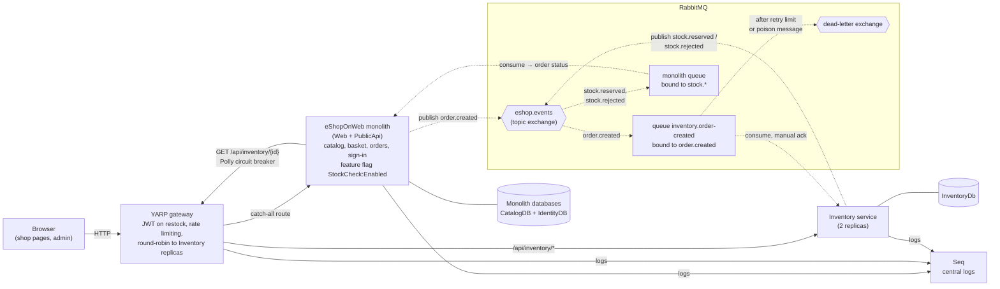

# Target architecture

This is my microservice design for eShopOnWeb. I work alone, so my instructor Jakob confirmed on 6/11-2026 that I build **one** microservice, **Inventory**, beside the monolith. I submit on 22/11-2026.
It builds on the business areas in [00-business-story.md](00-business-story.md) and the code coupling in [01-monolith-flows.md](01-monolith-flows.md).

This document is the single source of truth for the service, the routes and the message names. The work is planned in [PLAN.md](PLAN.md).

Solid arrows are HTTP calls, where the caller waits for an answer. Dotted arrows are messages, where the sender does not wait.
Plain lines join a service to the database only it may use.

## The parts

| Part | What it does |
|---|---|
| **YARP gateway** (`src/Gateway`) | The single entry point. `/api/inventory/*` goes to Inventory, and everything else goes to the monolith through a catch-all route. It validates the monolith's JWT on the restock endpoint, applies rate limiting, and spreads calls over the 2 Inventory replicas (round-robin). |
| **Monolith** | Still serves all pages, the catalog, the basket, orders and sign-in. It publishes `order.created`, listens for `stock.*`, and asks Inventory for availability on the product page. |
| **Inventory** (`src/Inventory.Api`) | Owns stock levels and reservations in its own `InventoryDb`. It reserves stock when an order is created and answers with `stock.reserved` or `stock.rejected`. |
| **RabbitMQ** | The topic exchange `eshop.events` routes messages by routing key. A dead-letter exchange receives messages that fail too many times. |
| **Seq** | Central logs from the monolith, the gateway and Inventory, searchable by `CorrelationId`. |

## Messages

All messages go through the topic exchange `eshop.events`. The client library is RabbitMQ.Client 7.

| Routing key | Published by | Consumed by | Content |
|---|---|---|---|
| `order.created` | Monolith (`IntegrationEventPublisher` translates the in-process `OrderCreatedEvent`) | Inventory, through the queue `inventory.order-created` | `OrderId` and the order lines with quantities, nothing else |
| `stock.reserved` | Inventory | Monolith | `CorrelationId = OrderId`. The order becomes `Confirmed`. |
| `stock.rejected` | Inventory | Monolith | `CorrelationId = OrderId`. The order becomes `Cancelled`. |

**Checkout in short:**

1. The monolith saves the order as `Pending` and publishes `order.created`.
2. Inventory tries to reserve every line: all lines or none, and never below zero.
3. If it can, it publishes `stock.reserved`, and the monolith marks the order `Confirmed`.
4. If it can't, it publishes `stock.rejected`, and the monolith marks the order `Cancelled`.

My Orders shows the status.

**Rules that keep it safe:**

| Rule | How |
|---|---|
| Duplicate messages | Inventory allows one reservation per `OrderId`, so a message that arrives twice reserves only once (idempotent receiver). |
| Two buyers, last unit | `rowversion` concurrency control, so only one of two reservations for the last unit succeeds. |
| A message keeps failing | It is retried up to a limit and then moved to the dead-letter exchange, so it can't block the queue. |
| Two replicas | Both read from the same queue (Competing Consumers), so each message is handled by one replica. |

## Inventory API

| Endpoint | Used by | Protection |
|---|---|---|
| `GET /api/inventory/{itemId}` | The product page, through the gateway, with a Polly circuit breaker and the fallback "availability unknown" | Open |
| `PUT /api/inventory/{itemId}/stock` | Admin restock | JWT from the monolith, validated at the gateway |
| `/health` | Health checks and the deploy job | Open |
| `/swagger` | API documentation | Open |

## Strangler Pattern steps

| Step | What changes | Rollback |
|---|---|---|
| 0 | The gateway goes in front of the monolith. All traffic still reaches the monolith through the catch-all route. | Point traffic straight at the monolith. |
| 1 | `/api/inventory/*` goes to the new Inventory service. | Remove the route. |
| 2 | Checkout checks stock through RabbitMQ, and the product page shows availability. | Set `StockCheck:Enabled` to `false`, and the shop works as it does today. |

Catalog, Basket, Ordering and Identity stay in the monolith for this project. They remain separate bounded contexts in [00-business-story.md](00-business-story.md), and Catalog is the natural next service to extract after the project.

## Why Inventory

I compared all five bounded contexts from [00-business-story.md](00-business-story.md) on the same five questions.

| Context | Required by the assignment? | Risk to the shop if it breaks | Tangled today | Business value | Fits one person in 12 days? |
|---|---|---|---|---|---|
| Catalog | No | Low (mostly reading) | Medium (Basket and Ordering read its tables) | High (most traffic) | Medium |
| Basket | No | Medium (writes on every click, sign-in merge) | High (reads Catalog, header item count) | Medium | Medium |
| Ordering | No | High (checkout stops) | Highest (three areas in one flow) | High | No |
| Identity | No | Highest (nobody can sign in) | Low (own database) | Low for this project | No (security work) |
| **Inventory** | **Yes (requirement 3)** | **Low (new code, feature flag)** | **None (new)** | **High (stops overselling)** | **Yes (small data)** |

Inventory is the only area the assignment requires as its own microservice, and it fixes a real gap: today the shop sells products without checking stock, which hurts most on busy sale days.
Because it is new code, it can't break the existing shop, and a feature flag turns it off instantly.
Its data is small and clear, so I can build it properly, with messaging, resilience and tests, in 12 days.

Catalog would be the best choice if I had to *extract* existing code, and it is my next step after the project. My instructor Jakob confirmed on 6/11-2026 that one service, Inventory, is enough because I work alone.
