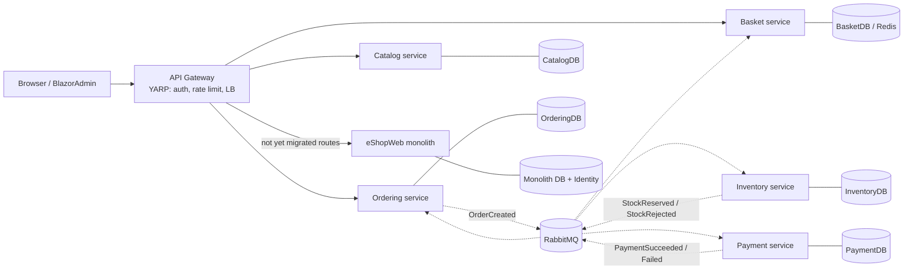

# Semester project plan: eShopOnWeb → microservices (Strangler Pattern)

Source requirements: `Semesteropgave.pdf` (9 requirements) and `Hvad_er_et_faerdigt_produkt_OPGAVE.pdf`
(turn each requirement into a concrete, checkable criterion). Baseline analysis: [01-monolith-flows.md](01-monolith-flows.md).

## Current state (what we start from)

- `src/Web` (MVC + Razor Pages) handles catalog, basket, checkout and identity in one process.
- `src/PublicApi` covers catalog CRUD + auth for `BlazorAdmin`.
- **One shared database** (`CatalogContext`) holds Catalog, Basket **and** Order tables. Identity has its own DB.
- Domain events are published in-process via Mediator (`OrderCreatedEvent`).
- No inventory and no payment. Checkout writes are not transactional.
- Already present and reusable: Dockerfiles for Web/PublicApi, `docker-compose.yml`, the Aspire AppHost +
  `AspireServiceDefaults` (OpenTelemetry, health checks), and the GitHub Actions workflow `dotnetcore.yml`.

## Target architecture

| Service | Owns | Exposes | Talks to others via |
|---|---|---|---|
| **Catalog** | items, brands, types, prices | REST `GET /api/catalog-items`, brands, types (+ admin CRUD) | publishes `ProductPriceChanged`, `ProductCreated` |
| **Basket** | baskets per buyerId (user or anonymous GUID) | REST `GET/POST/PUT /api/basket`, `POST /api/basket/transfer` | sync GET to Catalog for price/name; consumes `OrderCreated` → clear basket |
| **Ordering** | orders, order status | REST `POST /api/orders` (checkout), `GET /api/orders/my` | publishes `OrderCreated`; consumes stock/payment events; runs the checkout saga |
| **Inventory** (new) | stock on hand, reservations | REST `GET /api/inventory/{itemId}`, admin restock | consumes `OrderCreated`, `PaymentFailed`, `OrderCancelled`; publishes `StockReserved` / `StockRejected` |
| **Payment** (simulated) | payment attempts | none public (internal only) | consumes `StockReserved`; publishes `PaymentSucceeded` / `PaymentFailed` |
| **Monolith** (shrinks) | Identity, MVC UI, anything not yet migrated | existing pages | calls services through the gateway |

Checkout saga (orchestrated in Ordering): `Pending → StockReserved → Paid → Confirmed`, with compensations
`StockRejected → Cancelled` and `PaymentFailed → ReleaseStock → Cancelled`.

Technology choices (each one gets a short ADR in `architecture/adr/`):
- **Gateway:** YARP (.NET native) with ASP.NET Core JWT auth, `Microsoft.AspNetCore.RateLimiting`, and YARP's built-in load balancing over 2+ replicas.
- **Messaging:** RabbitMQ with MassTransit **v8** (v9 needs a commercial license). Outbox pattern in Ordering/Inventory.
- **Resilience:** `Microsoft.Extensions.Http.Resilience` (Polly): retry, timeout, circuit breaker on every sync HTTP call.
- **Observability:** OpenTelemetry (already in `AspireServiceDefaults`) → Prometheus + Grafana; Serilog structured logs with a correlation id → Seq or Loki.
- **Data:** SQL Server, one database per service (separate containers or at least separate DBs + logins). Basket can use Redis.
- **CI/CD:** GitHub Actions: build + test per service → Docker image → push to GHCR → deploy via docker compose (or Azure Container Apps, using the existing `infra/`).

## Phased roadmap (strangler order)

Each phase leaves the system running. The gateway decides per route whether the monolith or a service handles it.

| # | Phase | Main work | Exit check |
|---|---|---|---|
| 0 | **Analysis & docs** | Sequence diagrams (done), bounded contexts, ADR template, update README | `architecture/01-monolith-flows.md` + bounded-context section merged |
| 1 | **Gateway in front of monolith** | Add `src/Gateway` (YARP), route `/**` → monolith, add to compose/Aspire | Site works unchanged through gateway on one port; monolith port no longer published |
| 2 | **Platform plumbing** | RabbitMQ, Prometheus, Grafana, log sink in compose; shared `ServiceDefaults` (OTel, health, resilience) | All containers healthy; Grafana dashboard shows gateway + monolith metrics |
| 3 | **Catalog service** | Extract catalog read + admin endpoints (reuse PublicApi code), own CatalogDB, gateway routes `/api/catalog/**`; monolith's `CatalogViewModelService` calls the API through an HTTP client with a circuit breaker | Catalog page loads with monolith's catalog tables unused; stopping Catalog service shows a graceful fallback, not a 500 |
| 4 | **Inventory service (new)** | Stock + reservation model, seed stock for catalog items, REST + consumers | `OrderCreated` with qty > stock produces `StockRejected`; unit + integration tests green |
| 5 | **Basket service** | Extract basket aggregate + anonymous/user merge; monolith pages call Basket API | Add/update/merge basket works via API; Basket tables dropped from monolith DB |
| 6 | **Ordering + Payment + saga** | Extract `OrderService`, replace in-process Mediator event with RabbitMQ `OrderCreated`, saga with Inventory + Payment, real address from the form | Happy path → `Confirmed`; forced payment failure → stock released + `Cancelled`; basket cleared via event |
| 7 | **Gateway hardening** | JWT validation at gateway (token from Identity/monolith), rate-limit policy, 2 replicas of Catalog with load balancing | `429` after N req/s (test script); requests spread across replicas (logs/metrics); protected routes return `401` without a token |
| 8 | **CI/CD** | Workflow matrix per service: build, test, docker build, push to GHCR, deploy | Green pipeline run on `main` producing one image per service |
| 9 | **Final docs** | README: architecture, ADRs, API list (OpenAPI/Swagger per service), Inventory service interaction, runbook | A new person can run `docker compose up` from the README alone |

## "Færdigt produkt": concrete criteria per requirement

| # | Requirement | How we can verify it |
|---|---|---|
| 1 | Identify & bound services (≥ 3) | ≥ 3 services (Catalog, Basket, Ordering + Inventory, Payment), each in its own project/container with its own DB; README section justifying each boundary, with reference to the coupling points in `01-monolith-flows.md` |
| 2 | Strangler Pattern | Gateway route table in `src/Gateway/appsettings.json` shows migrated routes → services and the rest → monolith; git history/tags per phase; the site was usable after every phase (smoke test / Playwright run per phase) |
| 3 | Inventory as standalone service | `src/Services/Inventory` with its own Dockerfile + DB; reserving at checkout is observable (stock drops on order, restores on cancel); tests cover reserve/release/oversell |
| 4 | API Gateway (auth, LB, rate limiting) | One public entry port; `401` without a token on protected routes; `429` when the limit is exceeded; traffic split across ≥ 2 replicas visible in metrics |
| 5 | Async messaging | RabbitMQ in compose; named contracts (`OrderCreated`, `StockReserved`, `StockRejected`, `PaymentSucceeded`, `PaymentFailed`); RabbitMQ management UI shows exchanges/queues; Inventory down → order stays `Pending` and completes when it comes back |
| 6 | DB per service | One connection string per service, no service references another service's `DbContext`; cross-service data only via API or event (verified by project references: no service references another's Infrastructure) |
| 7 | Error handling & monitoring | Circuit breaker configured on every HttpClient (shown by killing Catalog → breaker opens, logged); `/health` on every service; Grafana dashboard with request rate/errors/latency per service; logs searchable by correlation id across services |
| 8 | CI/CD | `.github/workflows/*.yml` running build + test + docker build/push per service; badge in README; failing test blocks the pipeline |
| 9 | Documentation | README + `architecture/` with diagrams, ADRs, per-service API docs (Swagger), Inventory interaction diagram, how to run/test |

## Open decisions for the group

1. **Payment:** a simulated service (configurable success/fail) is assumed. Is that enough, or is a separate real integration expected?
2. **Prepared inventory system:** the assignment refers to an inventory system "you have made". If the group already has one, Phase 4 means integrating that code rather than writing it from scratch.
3. **Deployment target:** docker compose locally only, or also Azure (the repo already has `infra/` + `azure.yaml`)?
4. **Identity:** keep it in the monolith and issue JWTs from there (simplest), or extract an Identity service?
