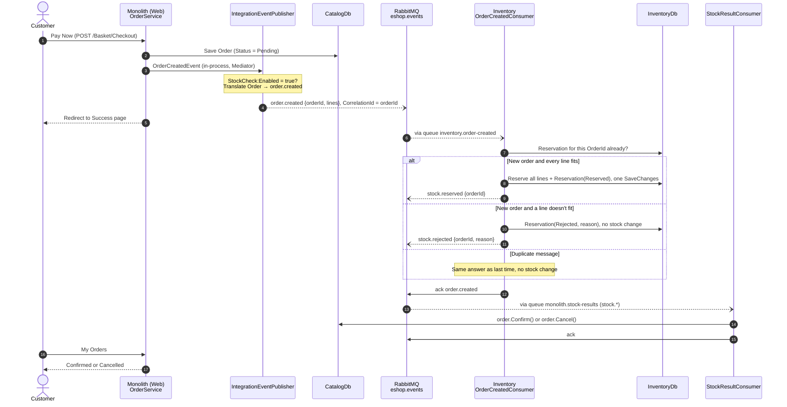

> **DRAFT.** AI-drafted from my code on 18/11-2026. I review and edit it before I submit.

# The order saga

## Why a saga

Placing an order now involves two services with two databases: the monolith saves the order in `CatalogDb`, and Inventory reserves stock in `InventoryDb`. One database transaction can't cover both. Instead I use a saga: a chain of local transactions, one per service, connected by messages. Each step commits on its own, and the order's status shows how far the saga has come.

My saga is choreographed. There is no central coordinator. Each service reacts to the other's events: the monolith publishes `order.created`, Inventory reacts and publishes `stock.reserved` or `stock.rejected`, and the monolith reacts to that.

## The flow

Arrows with an open head are messages, where the sender doesn't wait. Arrows with a filled head are calls that wait for an answer.

## The order's states

| Status | When | Code |
|---|---|---|
| `Pending` | The order is saved, and Inventory hasn't answered yet | `Order.Status` starts as `Pending` |
| `Confirmed` | `stock.reserved` arrived | `Order.Confirm()` |
| `Cancelled` | `stock.rejected` arrived | `Order.Cancel()` |

`Confirm()` and `Cancel()` only change a `Pending` order. This makes the monolith's side idempotent too. A duplicate `stock.reserved` changes nothing, and a late answer can't reopen an order that is already `Cancelled`. Five unit tests in `tests/UnitTests/ApplicationCore/Entities/OrderTests/OrderStatusChange.cs` check this.

The status is a new column, added with the migration `20261118113254_AddOrderStatus`. Orders placed before the migration get `Pending` as the default value. My Orders and the order detail page now show the real status instead of the hard-coded text "Pending" in `OrderViewModel`.

## Checkpoint 1: end to end in Docker

On 18/11, a day ahead of my plan, I ran the whole system in Docker Compose and placed real orders through the web shop as the demo user.

| Order | Basket | Inventory | Status in My Orders |
|---|---|---|---|
| 1 | item 1 × 2 | Reserved, stock 23 → 21 | `Confirmed` |
| 2 | item 2 × 4 | Rejected: "Not enough stock for item 2: wanted 4, have 1." | `Cancelled` |
| 3 | item 3 × 1, with `StockCheck:Enabled=false` | No message sent | `Pending` |

The logs show the saga step by step: "Published order.created for order 1" in the monolith, then "Order 1: Reserved" in Inventory, then "Order 1 is now Confirmed (stock.reserved)" in the monolith.

## The rollback switch

`StockCheck:Enabled` is the Strangler Pattern's way back. When it is `false`, `IntegrationEventPublisher` publishes nothing, and `StockResultConsumer` is not even started, so the monolith has no dependency on RabbitMQ. The shop then works exactly as before the migration: orders are saved and stay `Pending`, which is what My Orders always showed. In Docker I can switch it with an environment variable and no code change: `STOCK_CHECK_ENABLED=false docker compose up -d eshopwebmvc`. Order 3 above shows it works.

## Weak spots and future work

- **No compensation.** My saga has only one step that can fail, and that step (the reservation) is all-or-none, so nothing needs to be undone. But if a customer cancels a confirmed order later, the stock is not released. A real system needs an `order.cancelled` event that Inventory reacts to by adding the stock back.
- **No timeout.** If Inventory never answers, the order stays `Pending` forever. A timeout that cancels or flags old `Pending` orders would fix this.
- **Pending after a failed publish.** If RabbitMQ is down at checkout, the order stays `Pending` (see the dual-write problem in Message transformation). A Transactional Outbox would fix this.
- **Order Ids as idempotency keys.** Inventory remembers every `OrderId` it has handled. If the monolith's database were reset while `InventoryDb` was not, new orders would reuse old Ids and get old answers. In my Docker setup both databases live in the same container and are reset together.
